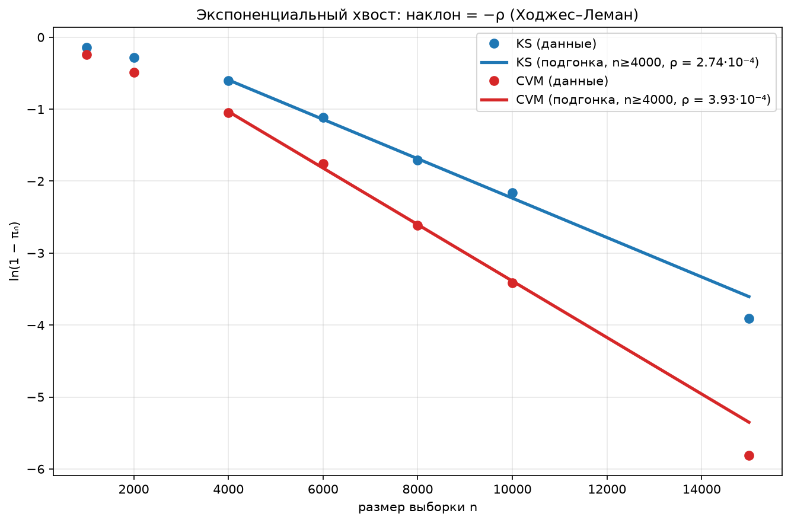

# Оценка показателя Ходжеса–Лемана ρ(θ)

Прототип численного метода оценки эффективности по Ходжесу–Леману на результатах power-эксперимента (δ = 0.04, α = 0.05, M = 5000).

## Метод

В экспоненциальном режиме ошибка второго рода убывает как

$$1 - \pi_n \approx C\, e^{-\rho n} \quad\Rightarrow\quad \ln(1 - \pi_n) \approx \ln C - \rho\, n.$$

Показатель $\rho$ оценивается как **наклон** прямой $\ln(1-\pi_n)$ по $n$ **взвешенным МНК**. Вес точки — обратная дисперсия (дельта-метод):

$$w_i = \frac{M\,(1-\hat\pi_i)}{\hat\pi_i}, \qquad \mathrm{Var}(\ln(1-\hat\pi_i)) \approx \frac{\hat\pi_i}{M(1-\hat\pi_i)}.$$

Доверительный интервал строится из ковариации коэффициентов, домноженной на оценённый по взвешенным остаткам масштаб $\hat\sigma^2$ (он честно учитывает шум хвоста и предасимптотическую кривизну).

## Результаты

| Критерий | режим | ρ̂ | se | 95% CI | σ̂² |
|---|---|---|---|---|---|
| KS | n ≥ 1000 (все) | 2.08·10⁻⁴ | 1.7·10⁻⁵ | [1.64, 2.52]·10⁻⁴ | 56.7 |
| KS | **n ≥ 4000 (хвост)** | **2.74·10⁻⁴** | 1.1·10⁻⁵ | **[2.38, 3.10]·10⁻⁴** | 5.5 |
| CVM | n ≥ 1000 (все) | 3.15·10⁻⁴ | 1.8·10⁻⁵ | [2.68, 3.61]·10⁻⁴ | 24.0 |
| CVM | **n ≥ 4000 (хвост)** | **3.93·10⁻⁴** | 1.4·10⁻⁵ | **[3.48, 4.37]·10⁻⁴** | 2.5 |

**Относительная эффективность**:

$$\mathrm{ARE} = \frac{\rho_{\mathrm{CVM}}}{\rho_{\mathrm{KS}}} = 1.43,\qquad 95\%\ \mathrm{CI} = [1.26, 1.64].$$

## Выводы

1. **Механизм работает.** По кривой мощности удаётся оценить показатель $\rho$ и относительную эффективность критериев с доверительным интервалом — то есть численный метод (наклон $\ln(1-\pi_n)$ по $n$) даёт искомую величину.

2. **CVM эффективнее KS** против сдвига среднего: $\rho_{\mathrm{CVM}} \approx 3.9\cdot10^{-4}$ против $\rho_{\mathrm{KS}} \approx 2.7\cdot10^{-4}$, то есть ARE ≈ 1.43 (на ~43% эффективнее). Доверительный интервал не накрывает 1, значит различие значимо. Качественно это согласуется с теорией (интегральные EDF-критерии выигрывают у KS на сдвигах).

3. **Важно брать хвост.** Подгонка по всем точкам (n ≥ 1000) даёт заниженный ρ и огромное $\hat\sigma^2 \approx 24$–57 — предасимптотические точки (маленькие n) не лежат на прямой. Ограничение на n ≥ 4000 (экспоненциальный режим) снижает $\hat\sigma^2$ до 2.5–5.5, то есть модель там адекватнее.

4. **Хвост всё ещё шумит.** Даже в режиме n ≥ 4000 $\hat\sigma^2 > 1$: точки с малым $1-\pi$ (например, CVM при n = 15000, $\pi=0.997$) имеют большую относительную ошибку. Это и есть «стена редких событий» — главное ограничение численного метода.

## Следующий шаг

Сверить численные $\rho$ с **аналитическими** значениями из литературы в пределах доверительного интервала. Если сойдутся — зашивать этот расчёт во фреймворк как стратегию `NumericalHLEfficiencyStrategy` и новый тип эксперимента `hodges_lehmann_efficiency`.
